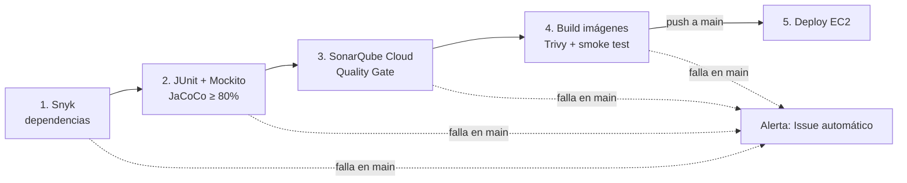

# MiniBiblioteca DevSecOps - EC2 Free Tier

Microservicio académico (Spring Boot 4 + Java 21) con un pipeline CI/CD completo en **GitHub Actions**: análisis de seguridad, pruebas automatizadas, Quality Gate, construcción y escaneo de imágenes, orquestación con **Docker Compose** y despliegue automático en **AWS EC2**.

> Evaluación Parcial N°2 · DOY0101 Ingeniería DevOps
> Integrantes: _(nombre 1)_ · _(nombre 2)_

---

## 1. Arquitectura

```text
Navegador ──80──► frontend (Nginx) ──balanceo──► backend réplica 1..N (Spring Boot :8080)
                   │  sirve HTML/CSS/JS          │  API REST /api/*
                   │  /api/* → backend_pool      │  repositorio en memoria
                   └──────── red interna minibiblioteca-net ────────┘
```

| Componente | Función | Límite |
|---|---|---|
| `frontend` | Nginx: publica la web y reparte `/api/*` entre las réplicas del backend | 96 MiB · 0.20 CPU |
| `backend` | Spring Boot: API REST (`/api/libros`, `/api/libros/{id}`, `/api/resumen`, `/api/health`) | 480 MiB · 0.60 CPU por réplica |
| Base de datos | No se usa: repositorio en memoria para caber en una EC2 de 1 GiB | 0 MiB |

Solo el puerto **80** se publica. El backend (8080) es accesible únicamente dentro de la red de Compose.

---

## 2. Pipeline CI/CD

Archivo: [`.github/workflows/ci-cd.yml`](.github/workflows/ci-cd.yml)



| # | Job | Qué hace | Evidencia que deja |
|---|---|---|---|
| 1 | `seguridad_snyk` | Analiza las dependencias Maven (SCA). En `main` registra el proyecto en Snyk para monitoreo continuo | Artifact `snyk-report`, tabla por severidad en el resumen |
| 2 | `pruebas` | `mvn clean verify`: 12 pruebas JUnit 5 + Mockito, reporte JaCoCo y mínimo de cobertura | Artifacts `jacoco-backend` y `surefire-reports`, resumen con pruebas y % de cobertura |
| 3 | `sonarcloud` | Análisis estático (bugs, vulnerabilidades, code smells, duplicación) con la cobertura de JaCoCo; espera el Quality Gate | Proyecto en SonarQube Cloud |
| 4 | `docker` | Construye las imágenes con el SHA del commit, las escanea con Trivy, levanta el stack con 2 réplicas y ejecuta el smoke test | Artifacts `trivy-reports` y `minibiblioteca-deploy` |
| 5 | `deploy` | Solo en `push` a `main`: copia las imágenes a la EC2 por SCP, `docker load` y `docker compose up -d --no-build`; verifica que la EC2 sirva ese commit | Deployment en el environment `production`, resumen del despliegue y bitácora en la EC2 |
| - | `alerta_seguridad` | Si cualquier barrera falla en `main`, abre un Issue con etiqueta `seguridad` | Issue en el repositorio y correo de GitHub |

**Flujo de ramas:** `dev` → Pull Request → `main`. El Pull Request ejecuta los jobs 1 a 4 (el deploy queda *Skipped*); el merge a `main` los repite y despliega.

La EC2 **no compila ni construye imágenes**: el trabajo pesado se hace en el runner de GitHub y la EC2 solo carga imágenes ya probadas.

---

## 3. Cómo se garantiza la calidad

El pipeline funciona como una serie de **barreras**: cada job depende del anterior (`needs`), así que si una barrera falla las siguientes quedan *Skipped* y **no se despliega nada**. La versión anterior sigue funcionando en la EC2.

| Barrera | Regla | Dónde se configura |
|---|---|---|
| Pruebas unitarias | Las 12 pruebas deben pasar (servicio, controller y repositorio) | `backend/src/test` |
| Cobertura mínima | ≥ 80% de líneas; si baja, `mvn verify` falla | `jacoco-check` en `backend/pom.xml` |
| Quality Gate | Condiciones de SonarQube Cloud sobre el código nuevo | SonarQube Cloud (`sonar.qualitygate.wait=true`) |
| Smoke test | Catálogo responde, id inexistente da 404, la versión publicada es el commit y las 2 réplicas reciben tráfico | Job `docker` |

Cobertura actual: **91,7% de líneas**. La única clase sin cubrir es `MiniBibliotecaApplication` (el `main`).

Pruebas incluidas:

| Clase de prueba | Qué valida |
|---|---|
| `LibroServiceTest` | Lógica de negocio con el repositorio simulado (`@Mock`): listar, buscar, libro inexistente, contar disponibles |
| `LibroControllerTest` | Capa HTTP con MockMvc: códigos 200/404, JSON devuelto y `/api/health` |
| `LibroRepositoryMemoriaTest` | Datos iniciales y búsqueda por id del repositorio real |

---

## 4. Seguridad: análisis, bloqueos y alertas

| Control | Qué analiza | Bloquea cuando | Parámetro |
|---|---|---|---|
| **Snyk** | Dependencias Maven | Hay una vulnerabilidad ≥ umbral | Variable `SNYK_SEVERITY_THRESHOLD` (por defecto `critical`) |
| **SonarQube Cloud** | Código fuente (incluye vulnerabilidades y *security hotspots*) | El Quality Gate queda en FAILED | Quality Gate del proyecto |
| **Trivy** | Imagen completa: Alpine, Java, Nginx y JARs | Hay una CVE con parche disponible ≥ umbral | Variable `TRIVY_SEVERITY` (por defecto `CRITICAL`) |
| **Dependabot** | Maven, imágenes Docker y GitHub Actions | No bloquea: abre PRs semanales que pasan por todo el pipeline | `.github/dependabot.yml` |

**Alertas:**
- Si una barrera falla en `main`, el job `alerta_seguridad` abre un **Issue** con el commit, el autor y el resultado de cada barrera.
- `snyk monitor` deja registrado `main` en Snyk: si después se publica una CVE nueva que afecte al proyecto, **Snyk avisa por correo** aunque nadie vuelva a ejecutar el pipeline.
- Con *Dependabot alerts* activado, GitHub notifica y abre un PR apenas aparece una CVE que afecte al proyecto.

**Endurecimiento de los contenedores:**
- Backend con usuario sin privilegios (`app`).
- Sistema de archivos de solo lectura (salvo `/tmp`).
- `no-new-privileges` y sin capacidades extra del kernel (`cap_drop: ALL`).
- Imágenes base con versión fija y `apk upgrade`.
- Backend no expuesto a Internet.
- Secretos solo en GitHub Secrets, nunca en el código.

---

## 5. Trazabilidad: del commit a producción

Cada despliegue se puede rastrear hasta el commit exacto que lo originó:

```text
commit abc1234 ──► pipeline (run #N) ──► imágenes minibiblioteca-*:abc1234 ──► EC2 sirve abc1234
```

| Evidencia | Dónde verla |
|---|---|
| Tag de las imágenes = SHA del commit | `docker images` en la EC2 o en el runner |
| Etiqueta OCI `org.opencontainers.image.revision` | `docker inspect minibiblioteca-backend:<sha>` |
| Versión publicada | `http://IP_PUBLICA/version.txt` |
| El smoke test y el deploy comprueban que `version.txt` sea igual al commit | Logs de los jobs `docker` y `deploy` |
| Historial de despliegues (qué commit, cuándo, quién) | Pestaña **Deployments** del repositorio (environment `production`) |
| Bitácora en el servidor | `/opt/minibiblioteca/logs/deployments.log` en la EC2 |
| Reportes de cada ejecución | Artifacts y *Summary* de cada run en **Actions** |

---

## 6. Orquestación y escalabilidad

**Elección: Docker Compose.**

Datos medidos para la decisión:

| Recurso | Valor |
|---|---|
| RAM de la EC2 (t3.micro, Learner Lab) | 913 MiB + 1 GiB de swap |
| Consumo por réplica del backend (`docker stats`) | ~115 MiB |
| Consumo del frontend Nginx | ~12 MiB |

> **Justificación técnica (redactar por el equipo, sin IA).** Preguntas guía:
> - ¿Cuánta memoria necesita un clúster Kubernetes mínimo (control plane + kubelet) comparado con la que tiene esta EC2?
> - ¿Qué capacidades de orquestación pide la pauta (réplicas, balanceo, recuperación, límites) y cuáles cubre Compose en este proyecto?
> - ¿En qué escenario (cantidad de servicios, nodos, tráfico) sí convendría migrar a Kubernetes?

| Característica | Cómo se implementa |
|---|---|
| Réplicas | `deploy.replicas: ${BACKEND_REPLICAS:-1}`; el pipeline prueba con 2 y la EC2 usa 1 por la RAM |
| Balanceo de carga | Nginx `upstream backend_pool` reparte las peticiones en round-robin |
| Escalado en caliente | `resolver 127.0.0.11` + `resolve`: Nginx detecta réplicas nuevas cada 10 s sin reiniciarse |
| Tolerancia a fallos | `max_fails` + `proxy_next_upstream`: si una réplica falla, la petición se reintenta en otra |
| Autorrecuperación | `healthcheck` + `restart: unless-stopped`; el frontend espera a que el backend esté `healthy` |
| Límites de recursos | `mem_limit` y `cpus` por contenedor y heap de Java acotado |
| Disco | Rotación de logs: 3 archivos de 10 MB por contenedor |

Escalar manualmente:

```bash
docker compose up -d --scale backend=3
```

Para ver qué réplica atendió una petición, revisa la cabecera `X-Backend-Replica` de cualquier respuesta `/api/*`.

---

## 7. Ejecutar localmente

```bash
# Pruebas + cobertura (reporte en backend/target/site/jacoco/index.html)
mvn -B -f backend/pom.xml clean verify

# Levantar el stack con 2 réplicas en http://localhost:8088
APP_VERSION=local APP_PORT=8088 BACKEND_REPLICAS=2 docker compose up -d --build
curl http://127.0.0.1:8088/api/health
curl http://127.0.0.1:8088/api/libros

# Detener
APP_VERSION=local APP_PORT=8088 docker compose down
```

---

## 8. Configuración del repositorio

**Secrets** (Settings → Secrets and variables → Actions → Secrets):

| Nombre | Valor |
|---|---|
| `AWS_HOST` | IP o DNS público de la EC2 |
| `AWS_USER` | `ec2-user` |
| `AWS_SSH_KEY` | Contenido completo del archivo `.pem` |
| `SNYK_TOKEN` | Token de Snyk |
| `SONAR_TOKEN` | Token de SonarQube Cloud |

**Variables** (pestaña Variables):

| Nombre | Valor |
|---|---|
| `SONAR_PROJECT_KEY` | Project Key de SonarQube Cloud |
| `SONAR_ORGANIZATION` | Organization Key de SonarQube Cloud |
| `SNYK_SEVERITY_THRESHOLD` | _(opcional)_ `critical` por defecto |
| `TRIVY_SEVERITY` | _(opcional)_ `CRITICAL` por defecto |

**Activar además:**
- Settings → Code security → **Dependabot alerts** y **Dependabot security updates**.
- Settings → Secrets and variables → **Dependabot**: duplicar `SNYK_TOKEN` y `SONAR_TOKEN`. GitHub no entrega los secrets de Actions a los PRs que abre Dependabot.
- SonarQube Cloud → Administration → Analysis Method: **Automatic Analysis desactivado**. El análisis lo hace el pipeline.

**EC2 (AWS Academy Learner Lab):**

| Elemento | Configuración |
|---|---|
| AMI / tipo | Amazon Linux 2023 · t3.micro (913 MiB RAM) |
| Grupo de seguridad (entrada) | SSH 22/TCP y HTTP 80/TCP desde `0.0.0.0/0`. **8080 no se abre** |
| Preparación (una sola vez) | `bash deploy/prepare-ec2.sh`: Docker, Compose v5.6.1, 1 GiB de swap, `/opt/minibiblioteca` y la marca `.bootstrap-ready` |

> En Learner Lab la IP pública cambia cada vez que se reinicia el laboratorio: hay que actualizar el secret `AWS_HOST`.

---

## 9. Incidentes detectados y corregidos

Problemas reales que el pipeline detectó durante el desarrollo. Ninguno llegó a producción: cada barrera detuvo el flujo hasta que se corrigió.

| # | Barrera que lo detectó | Problema | Corrección | Evidencia |
|---|---|---|---|---|
| 1 | Snyk (job 1) | Primer push a `main` sin `SNYK_TOKEN` configurado: el análisis no pudo ejecutarse y el pipeline se bloqueó | Configuración de Secrets y Variables | [Run bloqueado](https://github.com/SebaEscobar4/MiniBiblioteca-DevSecOps/actions/runs/41002471295) · [Issue #1](https://github.com/SebaEscobar4/MiniBiblioteca-DevSecOps/issues/1) creado por el job de alerta |
| 2 | Snyk (job 1) | Vulnerabilidad **Critical** `SNYK-JAVA-TOOLSJACKSONCORE-21761838` (Deserialization of Untrusted Data) en `tools.jackson.core:jackson-databind 3.1.7`, transitiva desde `spring-boot-starter-web 4.1.2` | Se fuerza `jackson-bom.version=3.1.8` en `backend/pom.xml`; se verificó `jackson-databind-3.1.8.jar` dentro del JAR | [PR bloqueado](https://github.com/SebaEscobar4/MiniBiblioteca-DevSecOps/actions/runs/41006858252) → [PR en verde](https://github.com/SebaEscobar4/MiniBiblioteca-DevSecOps/actions/runs/41007448820) |
| 3 | Concurrencia del workflow | Todos los runs compartían un grupo de concurrencia y se cancelaban entre sí (PRs de Dependabot cancelados) | Un grupo por rama y un grupo exclusivo, no cancelable, para el deploy | [PR #9](https://github.com/SebaEscobar4/MiniBiblioteca-DevSecOps/pull/9) |
| 4 | Dependabot | Propuso saltar de Java 21 (LTS) a Java 24/26/27 en las imágenes base | Regla `ignore` para versiones mayores de Java; los PRs #2, #4 y #10 se cierran sin merge | `.github/dependabot.yml` |
| 5 | Preparación de la EC2 | `prepare-ec2.sh` fallaba en Amazon Linux 2023: conflicto entre `curl` y `curl-minimal` preinstalado | Se instala solo `docker tar gzip`; `curl-minimal` ya provee el comando | Commit `ad0b4e8` |
| 6 | Deploy (job 5) | `upload-artifact@v4` omite archivos ocultos: el `.env` no llegaba a la EC2 y `scp` terminaba con código 255. Los contenedores en ejecución no se tocaron | `include-hidden-files: true`; además, el job de alerta ahora también vigila el deploy | [Deploy fallido](https://github.com/SebaEscobar4/MiniBiblioteca-DevSecOps/actions/runs/41010107919) → [Deploy exitoso](https://github.com/SebaEscobar4/MiniBiblioteca-DevSecOps/actions/runs/41011465143) · [PR #11](https://github.com/SebaEscobar4/MiniBiblioteca-DevSecOps/pull/11) |

---

## 10. Evidencias

### Resultado del despliegue verificado

Run [41011465143](https://github.com/SebaEscobar4/MiniBiblioteca-DevSecOps/actions/runs/41011465143): los 5 jobs en verde. Verificación externa:

| Comprobación | Resultado |
|---|---|
| `GET /` | HTTP 200 |
| `GET /api/health` | `{"status":"UP"}` |
| `GET /api/resumen` | `{"total":4,"disponibles":3}` |
| `GET /api/libros/999` | HTTP 404 |
| `GET /version.txt` | `f247d55cbe9096fca756414451e2d5b87a2b5834` (= commit del merge) |
| Puerto 8080 desde Internet | Cerrado |
| Bitácora en la EC2 | `2026-10-30T06:05:12Z commit=f247d55… actor=SebaEscobar4 run=…/41011465143` |

### Capturas por indicador

Guardar las imágenes en `docs/evidencias/` con estos nombres y enlazarlas aquí.

| IE | Captura | Nombre sugerido |
|---|---|---|
| IE1 | `docker images` mostrando las imágenes `minibiblioteca-*:<sha>` y su tamaño | `ie1-imagenes.png` |
| IE1 | Dockerfile multi-stage (las dos etapas) | `ie1-dockerfile.png` |
| IE2 | Summary del job 2: tabla de pruebas y cobertura | `ie2-pruebas-cobertura.png` |
| IE2 | Reporte HTML de JaCoCo (`index.html`) | `ie2-jacoco.png` |
| IE2 | SonarQube Cloud: Quality Gate **Passed** | `ie2-sonar-quality-gate.png` |
| IE3 | Job de Snyk bloqueado con la CVE Critical de jackson-databind | `ie3-snyk-bloqueo.png` |
| IE3 | El mismo PR en verde después de la corrección | `ie3-snyk-corregido.png` |
| IE3 | Issue #1 creado automáticamente por el job de alerta | `ie3-alerta-issue.png` |
| IE3 | Summary de Trivy con el umbral de bloqueo | `ie3-trivy.png` |
| IE3 | PRs abiertos por Dependabot | `ie3-dependabot.png` |
| IE4 | Pipeline completo en verde (vista del grafo de jobs) | `ie4-pipeline-verde.png` |
| IE4 | PR con *Deploy AWS EC2 → Skipped* | `ie4-pr-deploy-skipped.png` |
| IE4 | Summary del deploy (commit, autor, imágenes) | `ie4-resumen-deploy.png` |
| IE4 | Pestaña **Deployments** / environment `production` | `ie4-deployments.png` |
| IE4 | Navegador en `http://IP/` y `http://IP/version.txt` | `ie4-app-publicada.png` |
| IE5 | `docker compose ps` en la EC2 con ambos contenedores `healthy` | `ie5-compose-ps.png` |
| IE5 | Smoke test del job 4 con "Balanceo correcto: 2 réplicas" | `ie5-balanceo.png` |
| IE5 | `docker stats` con el consumo de memoria por contenedor | `ie5-recursos.png` |

---

## 11. Uso de Inteligencia Artificial

_(Revisar y ajustar esta declaración antes de entregar. Citar según https://bibliotecas.duoc.cl/ia)_

Se utilizó **Claude (Anthropic)**, mediante Claude Code, como apoyo para:
- Mejorar el Dockerfile (capas, healthcheck y etiquetas de trazabilidad).
- Escribir pruebas adicionales (`LibroControllerTest`, `LibroRepositoryMemoriaTest`) y la regla de cobertura mínima.
- Agregar al pipeline el escaneo con Trivy, los resúmenes, la verificación de versión y los jobs de alerta.
- Configurar réplicas, balanceo y tolerancia a fallos en Docker Compose y Nginx.
- Diagnosticar y corregir los incidentes de la sección 9 (vulnerabilidad de Jackson, concurrencia, script de la EC2, `.env` del deploy).
- Guiar la configuración de Snyk, SonarQube Cloud, GitHub Secrets y la instancia EC2.
- Redactar la parte descriptiva de este README.

Todo el contenido generado fue revisado, ejecutado y validado por el equipo. Las conclusiones, las justificaciones técnicas y las reflexiones individuales fueron redactadas por los integrantes **sin apoyo de IA**.

---

## 12. Conclusiones

> **Redactar por el equipo, sin IA.** Preguntas guía:
> - ¿Qué riesgo concreto habría llegado a producción sin cada barrera del pipeline? Usen los incidentes de la sección 9 como ejemplo.
> - ¿Por qué el orden Snyk → pruebas → Sonar → Docker → deploy, y no otro?
> - ¿Qué limitaciones tiene la solución (repositorio en memoria, una sola EC2, IP dinámica del Learner Lab) y cómo las mejorarían?
> - ¿Qué cambiarían si este microservicio fuera a producción real?

_(Texto del equipo.)_

### Reflexión individual - _(nombre 1)_

> Preguntas guía: ¿Qué aprendiste que no sabías antes del encargo? ¿Qué parte hiciste tú? ¿Qué te costó más y cómo lo resolviste?

_(Texto propio, sin IA.)_

### Reflexión individual - _(nombre 2)_

> Preguntas guía: ¿Qué aprendiste que no sabías antes del encargo? ¿Qué parte hiciste tú? ¿Qué te costó más y cómo lo resolviste?

_(Texto propio, sin IA.)_
