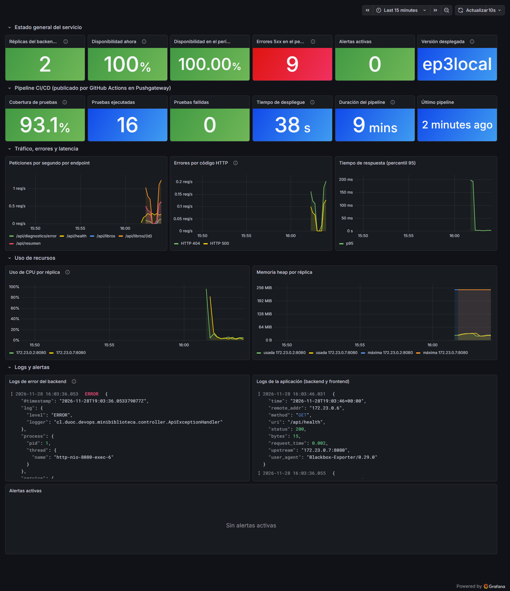

# EP3 — Observabilidad, Kubernetes y cumplimiento

Extensión del pipeline de la EP2 con monitoreo, logs, dashboards, despliegue orquestado y políticas de cumplimiento automatizadas.

| Ítem del encargo | IE | Dónde está |
|---|---|---|
| 1. Monitoreo de logs, métricas, errores y disponibilidad | IE1 | `observabilidad/`, backend con Actuator + Micrometer |
| 2. Despliegue en un entorno orquestado (Kubernetes) | IE2 | `k8s/`, job **6. Kubernetes y observabilidad** |
| 3. Dashboard con tiempo de despliegue, cobertura, CPU/memoria y errores | IE3 | `observabilidad/grafana/dashboards/minibiblioteca.json` |
| 4. Políticas de cumplimiento (SonarQube, branch protection, auditoría) | IE5 | job **0. Auditoría de cumplimiento**, `scripts/auditoria-cumplimiento.py`, `politicas/` |
| 5. Documentación de la integración y la toma de decisiones | IE4 | este documento |
| 6. El pipeline se detiene ante fallas críticas | IE6 | ramas `demo/*` (sección 7) |

---

## 1. Arquitectura de observabilidad

```text
                 métricas (scrape cada 15 s)
 backend x N ─────────────────────────────────┐
  /actuator/prometheus                        ▼
                                          Prometheus ──► reglas de alerta
 blackbox ── sondas HTTP al frontend ───────► │
 pushgateway ◄── métricas del pipeline CI/CD ─┤
                                              ▼
 logs JSON (stdout) ──► Alloy ──► Loki ──► Grafana (dashboard)
```

| Herramienta | Qué aporta | Señal |
|---|---|---|
| **Spring Boot Actuator + Micrometer** | Expone `/actuator/prometheus`: peticiones HTTP por endpoint y código, latencia, CPU, memoria JVM, más métricas propias (`minibiblioteca_build_info{version}` y catálogo) | Métricas de uso, errores, recursos |
| **Prometheus** | Recolecta las métricas cada 15 s y evalúa reglas de alerta | Métricas + alertas |
| **Blackbox exporter** | Prueba `/healthz` y `/api/health` desde afuera, como lo haría un usuario | Disponibilidad |
| **Pushgateway** | Recibe las métricas que envía el pipeline (un job de CI vive pocos minutos, por eso las "empuja") | Cobertura, pruebas, tiempo de despliegue |
| **Grafana Alloy + Loki** | Alloy lee los logs de los contenedores/pods y los guarda en Loki | Logs |
| **Grafana** | Dashboard versionado en Git ("dashboards as code") | Visualización |

Logs: el backend escribe en JSON con formato ECS (`logging.structured.format.console=ecs`) y Nginx con un `log_format` JSON, así se filtra por nivel, ruta o código sin parsear texto: `{service="backend"} | json | log_level="ERROR"`.

### Alertas configuradas (`observabilidad/prometheus/alertas.yml`)

| Alerta | Condición | Severidad |
|---|---|---|
| BackendSinReplicas | Ninguna réplica responde durante 1 min | crítica |
| ServicioNoDisponible | Una sonda falla durante 1 min | crítica |
| TasaDeErroresAlta | Más de 5 % de respuestas 5xx durante 2 min | advertencia |
| LatenciaAlta | Percentil 95 > 1 s durante 5 min | advertencia |
| MemoriaHeapAlta | Heap > 85 % durante 5 min | advertencia |
| CoberturaBajoElMinimo | El último pipeline reportó cobertura < 80 % | advertencia |

---

## 2. Dashboard (IE3)

Dashboard **"MiniBiblioteca - Observabilidad DevOps"** (`observabilidad/grafana/dashboards/minibiblioteca.json`, generado por `generar_dashboard.py`):

| Fila | Paneles |
|---|---|
| Estado general | Réplicas activas, disponibilidad actual y del período, errores 5xx, alertas activas, versión desplegada |
| Pipeline CI/CD | Cobertura de pruebas, pruebas ejecutadas y fallidas, **tiempo de despliegue**, duración del pipeline, último pipeline |
| Tráfico | Peticiones por segundo por endpoint, errores por código HTTP, latencia p95 |
| Recursos | **Uso de CPU** y **memoria heap** por réplica |
| Logs y alertas | Logs de error del backend, logs de la aplicación, tabla de alertas activas |



**Integración con CI/CD:** el job 6 despliega Grafana con este mismo dashboard, publica en Pushgateway la cobertura (de JaCoCo), las pruebas (de Surefire), el tiempo de despliegue (medido entre `kubectl apply` y el fin del rollout) y la duración del pipeline, y guarda una captura del dashboard como artifact. El resumen del job muestra las mismas métricas en una tabla.

---

## 3. Kubernetes (IE2)

El job **6. Kubernetes y observabilidad** crea un clúster Kubernetes con [kind](https://kind.sigs.k8s.io/) en el runner de GitHub Actions (infraestructura en la nube de GitHub/Azure) y despliega todo automáticamente en cada ejecución:

| Namespace | Contenido |
|---|---|
| `minibiblioteca` | backend (2-4 réplicas con HPA), frontend (2 réplicas), Services, PodDisruptionBudget, NetworkPolicies |
| `monitoreo` | Prometheus (descubre los pods por la API de Kubernetes), Pushgateway, Blackbox, Loki, Alloy, Grafana |

Configuración incluida para monitoreo y trazabilidad:
- Anotaciones `prometheus.io/scrape|path|port` en los pods del backend: Prometheus mide cada réplica nueva sin tocar su configuración.
- `startupProbe`, `livenessProbe` y `readinessProbe` sobre `/actuator/health/*`.
- Imágenes etiquetadas con el SHA del commit y anotación `kubernetes.io/change-cause` con commit y run: `kubectl rollout history` muestra qué versión se desplegó y desde qué pipeline.
- Los ConfigMaps de Prometheus, Grafana y Alloy se generan desde los mismos archivos de `observabilidad/` que usa Compose.

Seguridad de los manifiestos: namespace con **Pod Security Standards "restricted"**, contenedores sin root, sin escalada de privilegios, sin capabilities, sistema de archivos de solo lectura, requests/limits y NetworkPolicy que deniega todo por defecto.

Ejecutar en un clúster propio:

```bash
kubectl apply -k k8s/app
kubectl kustomize --load-restrictor LoadRestrictionsNone k8s/monitoreo | kubectl apply -f -
kubectl -n monitoreo port-forward svc/grafana 3000:3000
```

---

## 4. Cumplimiento automatizado (IE5)

Job **0. Auditoría de cumplimiento**, en paralelo con Snyk; si falla, no se construyen imágenes ni se despliega.

| Control | Herramienta | Qué detiene |
|---|---|---|
| Secretos en el historial de Git | Gitleaks | Contraseñas, tokens o llaves en cualquier commit |
| Malas configuraciones | Trivy (`config`) | Problemas HIGH/CRITICAL en Dockerfiles y manifiestos |
| Esquema de Kubernetes | kubeconform | Manifiestos inválidos |
| Políticas propias (41 controles) | `scripts/auditoria-cumplimiento.py` | Ver tabla siguiente |
| Calidad de código | SonarQube Cloud (job 3) | Quality Gate en FAILED |
| Revisión de cambios | Branch protection (`politicas/branch-protection.json`) | Merge a `main` sin checks en verde |

Políticas de la auditoría, mapeadas a normas:

| Área | Ejemplos de controles | Norma |
|---|---|---|
| Dockerfiles | Usuario no root, HEALTHCHECK, imágenes con versión fija, sin secretos en ENV/ARG | CIS Docker Benchmark 4.x |
| Kubernetes | No root, sin escalada ni privilegios, capabilities eliminadas, requests/limits, probes, PSA restricted, NetworkPolicy por defecto | CIS Kubernetes 5.x, Pod Security Standards, NSA/CISA |
| Pipeline | JaCoCo ≥ 80 %, gates de Snyk/Sonar/Trivy/auditoría, deploy solo desde `main` y tras las validaciones, actions con versión fija | ISO/IEC 27001 A.8.25–A.8.32, OWASP SAMM |
| Secretos y Compose | Sin `.env`/`.pem` versionados, backend endurecido, sin claves por defecto | ISO/IEC 27001 A.5.17, A.8.12 |

El reporte (Markdown + JSON) queda en el Summary del run y en el artifact `reporte-cumplimiento`.

**Branch protection:** se aplica una vez con un token de administración:

```bash
GITHUB_TOKEN=<token> bash scripts/configurar-branch-protection.sh
```

Exige Pull Request para `main`, que los 6 checks del pipeline estén en verde, conversaciones resueltas, y prohíbe force push y borrar la rama (también para administradores).

---

## 5. Cómo se integra todo en el pipeline (IE4)

```text
0. Auditoría ─┐
1. Snyk → 2. JUnit/JaCoCo → 3. SonarQube ─┴→ 4. Docker + Trivy + smoke → 6. Kubernetes + observabilidad → 5. Deploy EC2 (solo main)
```

| Etapa | Decisión técnica que permite tomar |
|---|---|
| Auditoría de cumplimiento | Si un cambio de infraestructura es seguro antes de construir nada |
| Snyk / Trivy | Si una dependencia o imagen tiene una vulnerabilidad que impide desplegar |
| JaCoCo / SonarQube | Si la calidad y la cobertura alcanzan el mínimo acordado |
| Job 6 (Kubernetes) | Si la versión arranca, escala y **es observable** antes de llegar a producción |
| Dashboard / alertas | Cuándo escalar (CPU/memoria), cuándo revertir (errores 5xx, disponibilidad), cuánto tarda un despliegue y si la cobertura baja con el tiempo |

---

## 6. Ejecutar localmente

```bash
APP_VERSION=local APP_PORT=8088 BACKEND_REPLICAS=2 \
  docker compose -f docker-compose.yml -f observabilidad/docker-compose.observabilidad.yml up -d --build

bash scripts/generar-trafico.sh http://localhost:8088 40
PUSHGATEWAY_URL=http://localhost:9091 COBERTURA=93 PRUEBAS_TOTAL=16 PRUEBAS_FALLIDAS=0 \
  DESPLIEGUE_SEGUNDOS=40 bash scripts/publicar-metricas-ci.sh
python3 scripts/auditoria-cumplimiento.py
```

- Grafana: http://localhost:3000 · Prometheus: http://localhost:9090
- Error controlado para probar alertas y paneles: http://localhost:8088/api/diagnostico/error

---

## 7. Demostración: el pipeline se detiene (IE6)

Cada rama `demo/*` introduce una falla a propósito. El push dispara el pipeline y este se detiene antes de construir o desplegar.

<!-- DEMOS -->
